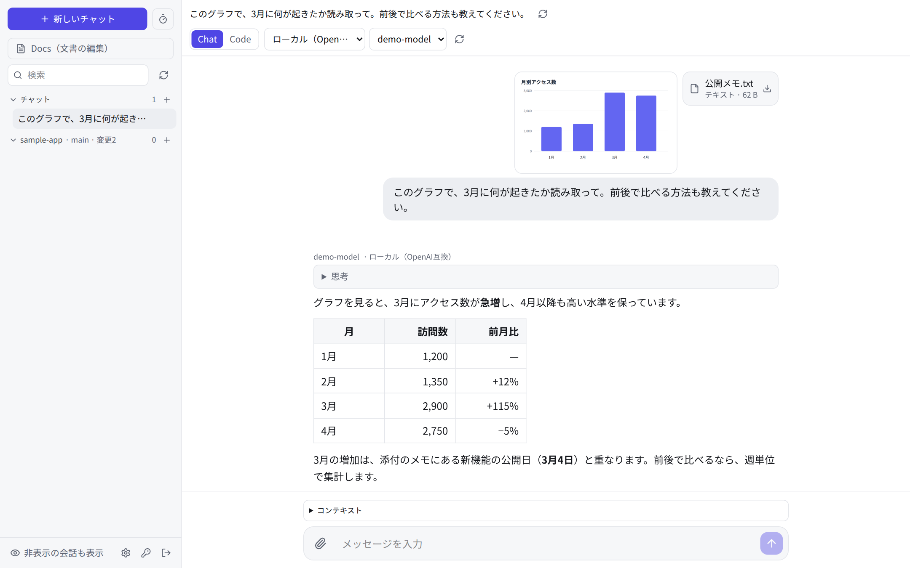
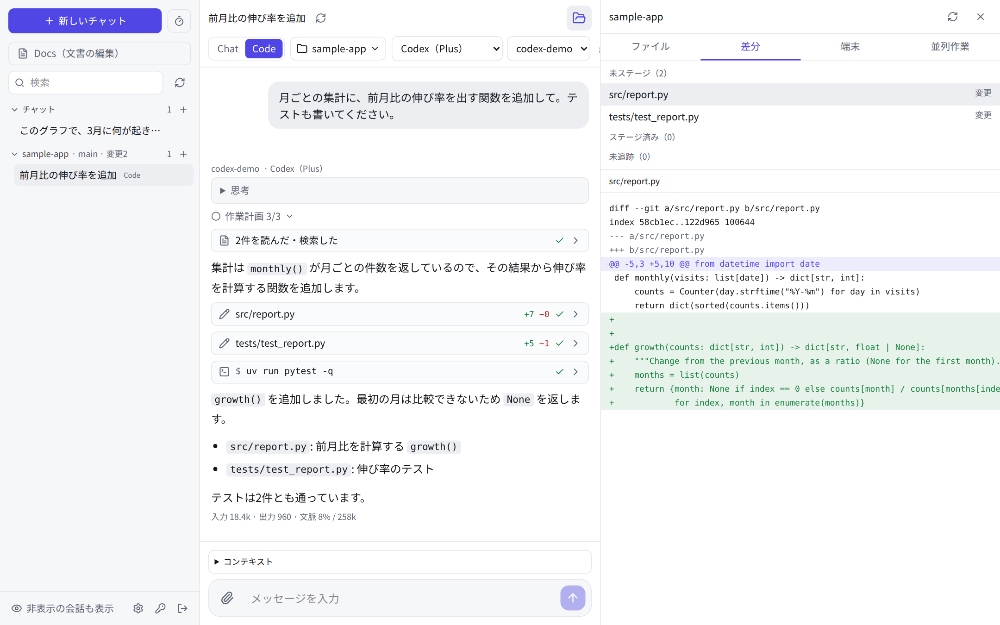
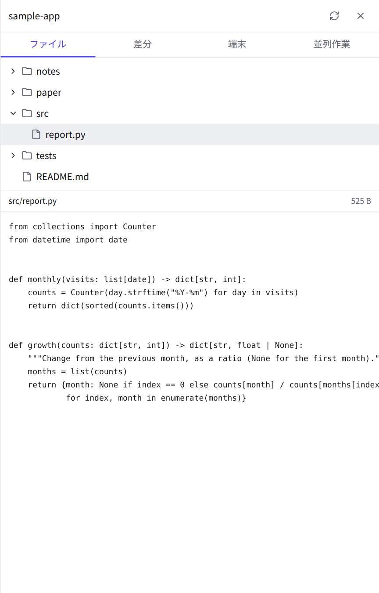
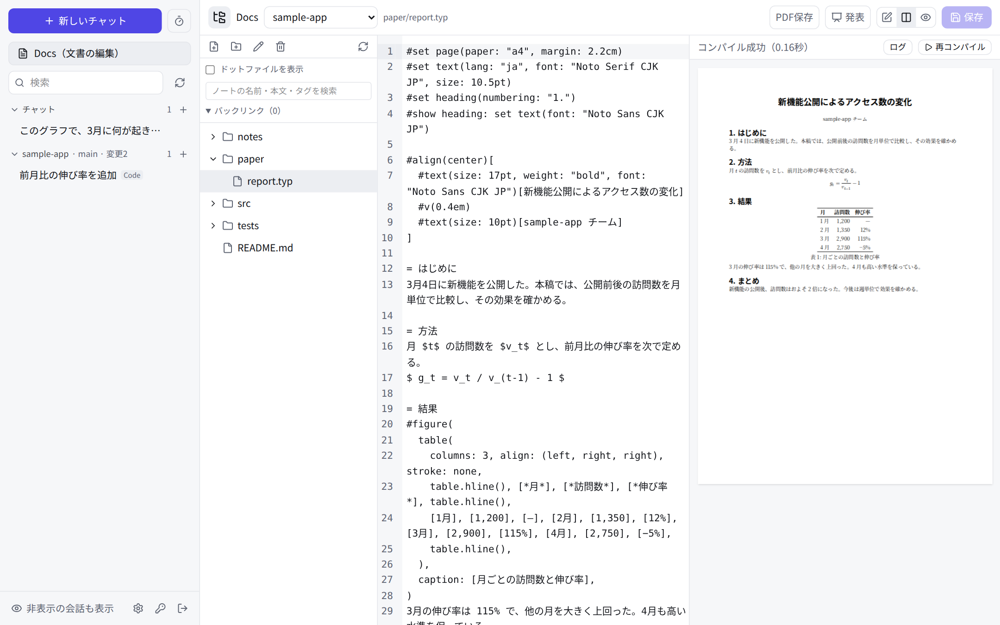
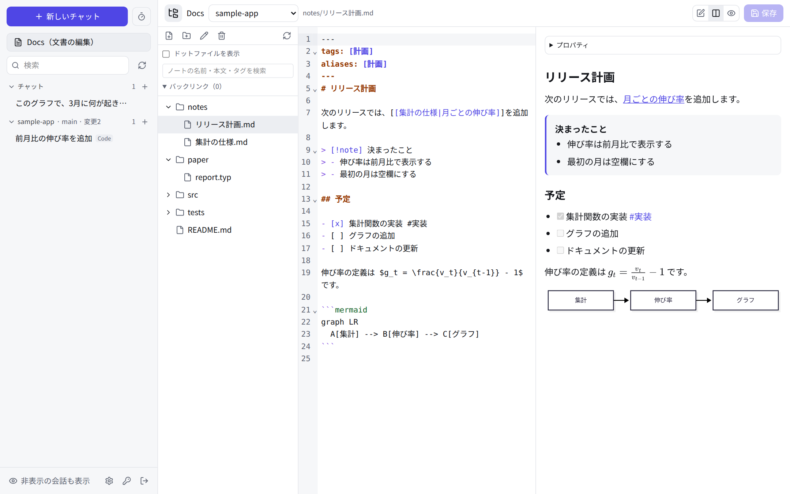
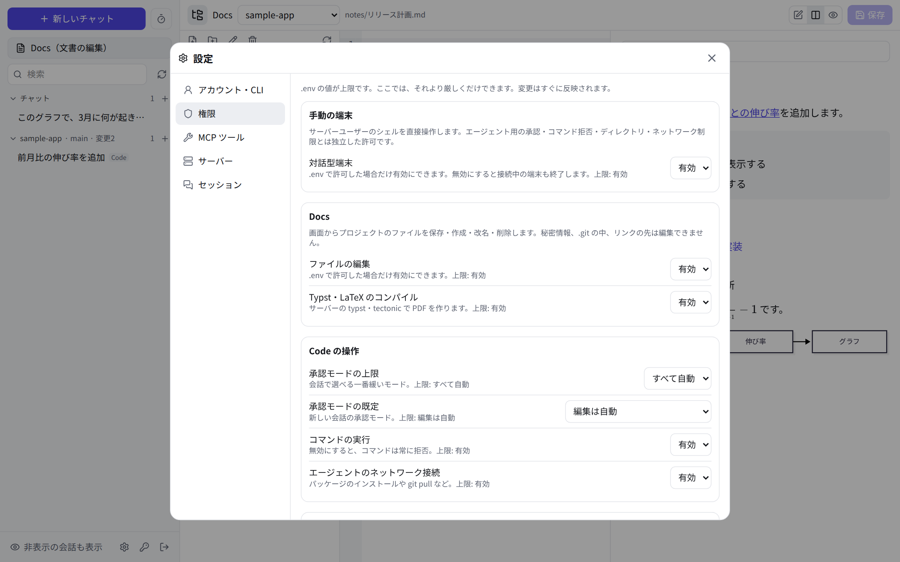
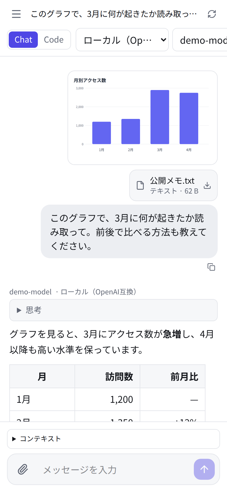

# OmniLLMWorkspace

自分のサーバーで動かす、LLMのワークスペースです。API・サブスクリプション・ローカルLLMを1つの画面で切り替えて使えます。

- **Chat**: プロジェクトに関係なく、モデルと会話します。
- **Code**: プロジェクトのフォルダで、エージェント（Codex、Claude Code、OpenCode、Antigravity CLI）に作業させます。
- ChatとCodeは、同じ会話の中で切り替えられます。
- **Docs**: プロジェクトのファイルを画面で編集します。Markdown は横にプレビューを表示します。
- スマホのブラウザからも使えます。ログインはパスキーです。

利用者が1人のセルフホストを前提にしています。



## できること

- **実行元の切り替え**: Anthropic・OpenAI・Gemini・OpenRouter のAPI、Ollama などのローカルLLM、Codex（ChatGPTのサブスクリプション）、Claude Code（サブスクリプションまたはAPI）、Antigravity CLI（agy）。
- **承認**: エージェントがコマンドの実行やファイルの編集をする前に、画面で確認できます。どこまで自動にするかは、会話ごとに選べます。
- **CLIの会話の取り込み**: ターミナルで使った Codex・Claude Code の会話を一覧に表示し、その続きをアプリから進められます。
- **ファイルと差分**: Code の画面で、プロジェクトのファイルと、コミットしていない変更を見られます。
- **端末**: Code の右パネルから対話型シェルを使えます。スマホでは全画面で開きます。専用の許可が必要です。
- **並列作業**: git worktree ごとに会話を作り、別々の指示、または同じ指示を複数の実行元へ送れます。返答と開始地点からの差分を比較できます。
- **使用率**: サブスクリプションの使用率と、会話の文脈の使用量を表示します。
- **ファイルの添付**: 画像・PDF・テキストのファイルを会話に添付できます。Code ではどんな形式でもエージェントに渡せます。
- **Web検索**: Chat の Claude API・Claude Code・Codex が、各社のサービス側でWeb検索を使えます。
- **MCP ツール**: Chat（API・ローカルのモデル）で MCP サーバーのツールを使えます。ツールを使うたびに確認します。

## 画面

画面の例です。デモ用のデータとモデルで撮影しています。

**Code**: エージェントの作業（作業計画・読んだファイル・編集・コマンド）を会話の中に表示し、右のパネルでプロジェクトの差分を確認できます。



**右サイドバー**: Code のフォルダボタンで開きます。ファイル・差分のほか、端末と並列作業（git worktree）のタブがあります。



**Docs**: Typst・LaTeX はサーバーでコンパイルし、横に PDF を表示します。



**Docs**: Markdown のノートは、wikilink・callout・数式・Mermaid の図を含めてプレビューします。



**設定**: サイドバー下の歯車から開きます。権限は `.env` の値を上限として、画面でより厳しくできます。



**スマホ**: 同じ画面をスマホのブラウザでも使えます。



## 必要なもの

- Linux または macOS
- Python 3.12 以降と [uv](https://docs.astral.sh/uv/)
- Node.js 22 以降（画面のビルドに使います）
- 使いたいものだけ:
  - Code で使うエージェントのCLI: [Codex](https://github.com/openai/codex)、[OpenCode](https://opencode.ai/)。Claude Code は同梱のSDKで動きます。
  - APIキー、またはローカルLLMのサーバー

## インストール

```sh
git clone https://github.com/ir0m/omni-llm-workspace.git
cd omni-llm-workspace
cp .env.example .env
uv sync --locked
(cd web && npm ci && npm run build)
```

## 設定

`.env` に値を書きます。各項目の説明は [.env.example](.env.example) にあります。最初に、次の3つを確認してください。

| 項目 | 内容 |
|---|---|
| `OMNI_SECRET` | ログイン情報の署名とMCP認証情報の暗号化に使う長いランダム文字列。`openssl rand -hex 32` などで作ります。未設定ならデータフォルダの `secret.key` に自動生成します。 |
| `OMNI_PUBLIC_URLS` | ブラウザで開くURL。パスキーは HTTPS か `http://localhost` でだけ使えます。 |
| `OMNI_PROJECTS_DIR` | Code のプロジェクトを置くフォルダ。この直下のフォルダが、1つずつプロジェクトになります。既存のリポジトリはシンボリックリンクで置けます。画面から作るときに `仕事/顧客A/app` のように `/` で区切ると、5階層までフォルダの中に作れます（途中のフォルダはグループになり、プロジェクトとしては選べません）。 |

使うサービスに合わせて、APIキーやローカルLLMのURLも書きます。

空の値は未設定として扱い、環境変数は `.env` より優先します。`.env` の変更はサーバーの再起動で反映されます。設定画面で変更した権限やモデルの既定値はデータベースに保存され、再起動後も残ります。権限は `.env` の上限を超えて有効にできません。

### サブスクリプション

資格情報は `.env` に書きません。各CLIに自分でログインすると、アプリはそのログインを使います。

- ChatGPT（Codex）: `codex login`
- Claude（Claude Code）: `claude auth login` を実行し、`.env` の `OMNI_ALLOW_CLAUDE_SUBSCRIPTION=true` で有効にします。アプリは Claude.ai の資格情報を扱わず、CLI自身のログインだけを使います。利用は個人の責任で行ってください。
- Google（Antigravity CLI）: `agy` をインストールして端末でログインし、`.env` の `OMNI_ALLOW_AGY=true` で有効にします。`agy acp` で Chat と Code に使います。Antigravity の規約では外部のツールからの利用の扱いがはっきりしないため、利用は個人の責任で行ってください。アプリは Google の資格情報を扱いません。

### 権限

Code でエージェントができることの上限は `.env` で決まります。画面ではこれより厳しくできますが、緩めることはできません。

- `OMNI_APPROVAL_DEFAULT` / `OMNI_APPROVAL_MAX`: 承認モードの既定値と、選べる一番緩いモード
  - `ask`: 読み取り以外はすべて確認
  - `auto_edit`: プロジェクト内の編集は自動、コマンドは確認
  - `auto`: 拒否するコマンド以外は自動
- `OMNI_OUTSIDE_READ` / `OMNI_OUTSIDE_WRITE`: プロジェクト外の読み取り／編集・コマンド（`mode`=承認モードに従う、`ask`=常に確認、`deny`=常に拒否）
- `OMNI_ALLOW_SHELL`: コマンドの実行を許すか
- `OMNI_ALLOW_NETWORK`: エージェントのネットワーク接続を許すか
- `OMNI_SHELL_DENY`: エージェントに常に拒否するコマンド
- `OMNI_ALLOW_TERMINAL`: 手動の対話型端末を許すか。既定は `false`。有効にすると、サーバーの実行ユーザーとして直接操作できます。エージェントの承認・コマンド拒否・ディレクトリ・ネットワーク制限とは独立した許可です。
- `OMNI_ALLOW_FILE_EDIT`: Docs での保存・作成・改名・削除を許すか。既定は `false`。無効でも閲覧はできます。エージェントの承認とは独立した許可です。
- `OMNI_ALLOW_COMPILE`: Docs での Typst・LaTeX のコンパイルを許すか。既定は `true`。
- `OMNI_ALLOW_NATIVE_SESSION_CHANGES`: CLI側の改名・分岐・明示的な削除を許すか。既定は `true`。

`.env` などの秘密情報、鍵ファイル、`.git` の中、アプリのデータは、`auto` 以外では常に確認します（「常に許可」や `auto_edit` でも自動にはなりません）。Claude Code には、`.env` と鍵ファイル、アプリのデータの読み取りを許可しません。

### Web検索

Chat では、Claude API・Claude Code・Codex がWeb検索を使えます（既定で有効）。検索は各社のサービス側で行い、このマシンからWebページを取得することはありません。Claude API では検索に加えて、会話に出てきたURLのページ取得も使えます。検索や取得の内容は、返答の中にカードで表示されます。

- 無効にするには `.env` で `OMNI_CHAT_WEB_SEARCH=false` にします。
- Claude API の検索は、組織の設定（Console）でWeb検索が許可されている必要があり、利用料が別にかかります。
- OpenAI API・互換API・ローカルのモデル・OpenCode・Antigravity では使えません。

### MCP ツール

`.env` の `OMNI_ALLOW_MCP=true` で有効になります。サーバー上でコマンドを起動するローカルのサーバー（stdio）は、さらに `OMNI_ALLOW_MCP_STDIO=true` が必要です。

サーバーは設定画面の「MCP ツール」で追加します。トークンなどの環境変数・ヘッダーは暗号化して保存し、画面には表示しません。ツールを使うたびに確認します。会話ごとに「常に許可」を選べるほか、設定画面でツールごとに常に許可できます。会話ごとに、入力欄の上のボタンで使うサーバーを外せます。ツールに対応していないモデルは、ツールなしで返答します。

HTTP接続は Streamable HTTP のエンドポイントを指定します。HTTPS、または同じマシンの `http://localhost`・`http://127.0.0.1`・`http://[::1]` が使えます。認証情報はURLのユーザー名・パスワード欄ではなくヘッダーに設定してください。接続確認でツール一覧を取得できます。会話中のサーバー選択は、返答が終わってから変更できます。CLIエージェントのMCP設定とは別の機能です。

### 会話の操作

- キーボードでは Enter で送信、Shift+Enter で改行します。日本語変換中の Enter では送信しません。タッチ端末では Enter は改行になり、送信ボタンで送ります。
- 入力途中の文章はブラウザ内に保存され、会話の切り替えや再読み込み後に戻ります。別のブラウザ・端末には同期しません。ブラウザの保存機能が無効な場合は、再読み込み後の復元はできません。
- 応答中も追加指示を送れます。対応するエージェントには作業中に渡し、それ以外は現在の返答が終わったあとに送ります。送れなかった指示は入力欄に戻します。
- 画面を閉じてもサーバー上の応答は続きます。再度開くと途中から表示します。止める場合は停止ボタンを使います。
- 「一時」の会話もアプリ内には保存されます。CLI側の記録・メモリを残さないための設定で、履歴を自動削除する機能ではありません。

### ファイルの添付

入力欄のクリップボタンから選ぶほか、入力欄へのドラッグ＆ドロップ、画像の貼り付けでも添付できます。1回に10個、合計50 MiBまでです。

| 送り先 | 送れるもの |
|---|---|
| Claude API | 画像・PDF・テキスト |
| OpenAI・OpenRouter | 画像・PDF・テキスト |
| Gemini・Ollama・ローカルのOpenAI互換 | 画像・テキスト |
| Chat の Codex・OpenCode・Antigravity | 画像・テキスト（OpenCode・Antigravity は、エージェントが画像入力に対応している場合） |
| Chat の Claude Code | 画像・PDF・テキスト |
| Code のエージェント | すべての形式 |

- 画像は PNG・JPEG・GIF・WebP で、1枚5 MiBまでです。大きな写真と iPhone の HEIC は、ブラウザで長辺2576pxまでの JPEG に変換してから送ります。テキストは UTF-8 で1 MiBまで、ほかのファイルは20 MiBまでです。
- 形式はファイルの中身から判定します。送り先が受け取れない形式は、送信前に理由を表示し、入力欄に残します。画像に対応していないことが分かっているモデルにも画像は送りません。
- テキストのファイルは、名前つきで本文に含めて送ります。
- Code では、添付したファイルをプロジェクトの `.omni-attachments/` にコピーし、そのパスをエージェントに伝えます。このフォルダは `.git/info/exclude` に追加するので、`git status` には出ません。不要になったら削除してください。
- 添付したファイルはアプリのデータフォルダに保存し、続きの会話や実行元の切り替え後にも送ります。切り替え先が受け取れない形式は、ファイル名だけを伝えます。会話を削除すると、どの会話からも使われていないファイルは削除します。送信しなかったアップロードは1日後に削除します。
- 応答中に送る追加指示には添付できません。

### 引き継ぎ要約とコンテキスト圧縮

会話の入力欄の上にある「コンテキスト」から操作します。返答中は操作できません。

- **共通要約を作成・更新**: 選択中の実行元・モデルを使い、古い会話の目的・制約・判断理由・検証結果・未解決事項を要約します。表示された思考とツールの記録も要約の材料にします。直近3往復は原文で残します。要約を作る際には追加の利用量が発生し、画面で入力・出力トークン数を確認できます。
- **共通要約を解除**: APIへの送信や新しいエージェントへの引き継ぎに、元の履歴を使う設定に戻します。履歴自体は圧縮時にも削除されません。CLIの既存セッションを巻き戻す操作ではありません。
- **実行元の圧縮**: Claude APIとResponses方式のOpenAI API、Codex・Claude Codeの既存セッションを、それぞれの専用機能で圧縮します。モデル・CLIのバージョンによっては非対応です。CLIでは `OMNI_ALLOW_NATIVE_SESSION_CHANGES=true` が必要です。

共通要約は実行元を切り替えても使えます。元の履歴が取り込みなどで変更されると、対応しなくなった要約は使いません。要約生成中に会話が更新された場合は結果を適用せず、再実行を案内します。要約には情報の欠落があり得るため、表示された内容と元の履歴を確認できます。自動圧縮は行わず、ボタンを押したときに実行します。

Claude APIでは同じモデル・system指定の継続時に署名付きの思考を保持します。OpenAIは `.env` の `OMNI_OPENAI_RESPONSES=true` でResponses方式に切り替えると、暗号化された思考を保持できます。既定のChat Completions方式は互換サービス向けに継続して使えます。専用の思考データは実行元・モデル・通信方式ごとに保存され、異なる実行元への引き継ぎや画面表示には使いません。共通要約の変更時には再構築します。

MCP利用中は、そのターン内のツール往復で思考データを保持します。ターンをまたぐ専用データの再送は行いません（ツール定義の変更で署名が無効になることを避けるため）。既存CLIのコンテキスト量を減らすには「実行元の圧縮」を使ってください。OpenCode・Antigravityや互換APIには共通要約が使えますが、専用の手動圧縮は未対応です。

### 端末・並列作業・CLIの会話

Code のフォルダボタンから「端末」「並列作業」を開きます。端末は接続ボタンで起動し、タブの切り替え・画面を閉じる操作・通信切断で終了します。リバースプロキシでは WebSocket の転送を有効にしてください。

並列作業は、開始地点をローカル／リモート追跡ブランチの一覧から選び、その先頭コミットから独立したフォルダとブランチを作ります。一覧はサーバー内のGit情報を使い、自動でfetchは行いません。未コミット変更・未追跡ファイル（`.env` など）はコピーしません。実行中の承認は各会話を開いて行います。「元フォルダへ統合」は、両方のフォルダに未コミット変更がなく、fast-forwardできる場合に使えます。ブランチが分岐している場合は端末で統合してください。作業フォルダを削除しても会話とブランチは残ります。

CLIと紐付いた会話の改名・分岐は、元のCLI側にも反映します。削除は「アプリ内のみ削除」「CLI側も削除」から選びます。後者は元に戻せず、Codexが生成した子セッションも対象になります。アプリ内のみ削除した会話は自動で再取り込みしません。

### Docs

サイドバーの「Docs」から開きます。プロジェクトを選び、ファイル一覧からファイルを開いて編集します。保存は保存ボタンか Ctrl+S（⌘S）です。

- 「ドットファイルを表示」で、`.gitignore` や `.agents/` など、名前が `.` で始まるファイル・フォルダの表示を切り替えます。既定は非表示で、選択はブラウザに保存します。検索結果・バックリンク・補完にも反映し、開いている文書や未保存の変更は保持します。`.env`・鍵ファイル・`.git` などのアクセス制限は変わりません。
- 読み込んだあとにエージェントや別の画面がファイルを変更していた場合、保存は行わず確認を表示します。「読み込み直す」か「上書き保存」を選びます。
- 編集できるのは 2 MiB までの UTF-8 のテキストです。`.env` などの秘密情報、鍵ファイル、`.git` の中、シンボリックリンクの先は編集できません。
- **Typst・LaTeX**: `.typ` と `.tex` は、開いたときと保存したときにサーバーでコンパイルし、横に PDF を表示します。エラーは行番号つきで表示し、押すとその行へ移動します。失敗したときは、前回成功した PDF を表示したままにします。プロジェクト内の PDF ファイルも表示できます。
- フォルダは、一覧でクリックして選ぶと改名・移動・削除できます（クリックで開閉もします）。中身があるフォルダは、中のファイル・フォルダの件数とサイズを確認してから中身ごと削除します。確認したあとに中身が増えていた場合は削除せず、もう一度確認を求めます。Docs に表示されない項目（`.env` などの秘密情報、鍵ファイル、`.git`、アプリのデータ）や別のファイルシステムを含むフォルダは削除できないので、端末かエージェントで削除してください。中のシンボリックリンクは、リンク自体だけを削除します。
- 保存していない変更は、Chat・Code に切り替えても残ります。ブラウザの再読み込みでは失われます。

### Markdown・Obsidian のノート

プロジェクトを1つの vault として扱います。Obsidian自体やプラグインを起動する必要はありません。

- `[[ノート]]`、`[[フォルダ/ノート#見出し|表示名]]`、MarkdownリンクからDocs内を移動できます。`[[` を入力するとノート名を補完します。同名の候補が複数ある場合は、フォルダを指定してください。
- `![[ノート]]`、見出し・ブロックの埋め込み、画像、PDF、callout（折りたたみを含む）、タグ、frontmatter、KaTeXの数式、Mermaidの図を表示します。循環参照を止め、ノートの埋め込みは最大4階層に制限します。
- ファイル一覧の上で、名前・本文・タグ・別名を検索できます。開いているノートへのバックリンクも表示します。保存・一覧更新時と15秒ごとに索引を更新します。
- 索引は最大2000ノート・10000項目・本文合計16 MiBです。上限に達した場合は画面に表示します。秘密情報、リンクの先、アプリのデータ、`node_modules`、`.venv` は検索しません。
- `.obsidian` の設定やプラグインは実行しません。Dataview、Canvas、グラフ、Obsidian風ライブプレビュー、改名時のリンクの一括書き換えは対象外です。

### スライドと発表

frontmatterに `marp: true` があるMarkdownは、編集中にスライドをプレビューします。ローカル画像は文書からの相対パスで指定できます。

- **発表**: Marp、プロジェクト内のPDF、Typst・LaTeXの生成PDFから開けます。現在・次のスライド、発表者ノート、タイマーを表示します。未保存の変更は発表に含まれません。
- **投影**: 「投影用の画面を開く」で別ウィンドウを開きます。同じブラウザの発表者画面と同期し、矢印キーでページ送り、Bで暗転、投影側のFで全画面表示できます。
- **ノート**: MarpではHTMLコメントに記入します。PDFの場合は隣に `資料.notes.md` を置き、`---` の行でページごとに区切ります（`資料.pdf`・`資料.typ`・`資料.tex` 共通）。
- **PDF保存**: 生成済みPDFには保存リンクがあります。Marpは発表者ビューの「PDFに保存・印刷」から、ブラウザの印刷ダイアログでPDF保存します。標準の16:9レイアウトに対応します。
- スマホからのリモコン、ペン注釈、手書きノートは含みません。

### Typst・LaTeX のコンパイル

サーバーに [typst](https://github.com/typst/typst) と [tectonic](https://tectonic-typesetting.github.io/) を入れると使えます。`PATH` のほか `~/.local/bin` と `~/.cargo/bin` も探します。入れたあとはサーバーを再起動してください。

- `OMNI_ALLOW_COMPILE`（既定は `true`）で無効にできます。
- 生成した PDF はアプリのデータフォルダに置き、プロジェクトのフォルダには何も書き込みません。
- 実行環境はLinux（Landlock ABI 3以降）と `libseccomp.so.2` を前提とします。隔離できない環境ではコンパイルを実行せず、ログに理由を表示します。
- プロジェクトの公開ファイルだけを一時フォルダにコピーしてコンパイルします。秘密情報とシンボリックリンクは除外します。読み取りは一時フォルダ・コンパイラ・システム資源、書き込みは一時フォルダとコンパイラ用キャッシュに制限します。
- LaTeX はさらに `--untrusted` でシェル実行を無効にします。ネットワークを許可した場合、tectonic と Typst は不足するパッケージを取得します。初回は時間がかかることがあります。
- `OMNI_ALLOW_NETWORK=false` は両コンパイラのソケット作成を禁止します。取得済みパッケージだけで処理し、不足する場合は失敗します。
- 入力は合計128 MiB・10000項目、PDFは64 MiB、メモリは2 GiB、コンパイルは120秒までです。日本語を使う場合は、サーバーに日本語フォントが必要です。

## 起動

```sh
uv run python -m omniws
```

既定では `127.0.0.1:8300` で待ち受けます。外部には直接公開せず、[Tailscale Serve](https://tailscale.com/kb/1312/serve) などのHTTPSのリバースプロキシを使って開いてください。そのURLを `OMNI_PUBLIC_URLS` に書きます。そこに指定したホスト名は自動で許可されます。それ以外のホスト名でアクセスする場合に `OMNI_ALLOWED_HOSTS` を使います。

### 最初のパスキー登録

サーバーで次を実行すると、登録用のリンクが表示されます。リンクは15分間、1回だけ使えます。

```sh
uv run python -m omniws passkey-link
```

登録したい端末でこのリンクを開き、パスキーを作ります。以後は「パスキーでログイン」を使います。

- パスキーの追加・削除は、サイドバーの下にある鍵のアイコンから行えます。
- すべての端末を失くしたときは、サーバーで登録リンクを作り直します。

### 常駐させる

systemd のユーザーサービスの例が [deploy/systemd/omni-llm-workspace.service](deploy/systemd/omni-llm-workspace.service) にあります。`WorkingDirectory` と `ExecStart` を、クローンした場所に合わせて書き換えてから使ってください。

```sh
mkdir -p ~/.config/systemd/user
cp deploy/systemd/omni-llm-workspace.service ~/.config/systemd/user/
systemctl --user daemon-reload
systemctl --user enable --now omni-llm-workspace
```

## 更新

作業中の返答や端末操作を終えてから更新してください。サーバーを再起動すると実行中の処理は中断されます。

```sh
git pull --ff-only
uv sync --locked
(cd web && npm ci && npm run build)
systemctl --user restart omni-llm-workspace   # 常駐させている場合
```

画面を更新してサーバーをまだ再起動していないときは、サイドバーに「反映待ち」と表示されます。

### バックアップ

サーバーを停止してから、`.env` と `OMNI_DATA_DIR`（既定は `./data`）のフォルダ全体を保存してください。会話、添付ファイル、パスキーの登録情報、画面の設定、MCP認証情報はここにあります。`OMNI_SECRET` または自動生成された `secret.key` も同じものを復元してください。鍵が変わると保存済みのMCP認証情報を復号できず、再入力が必要です。

プロジェクトのファイル・worktreeと、CLI自身の履歴・ログインは別に保存されています。必要に応じてそちらもバックアップしてください。

### 困ったとき

| 症状 | 確認すること |
|---|---|
| サーバーに接続できない | 起動状態と待ち受けURLを確認し、画面の「再接続」を押します。`curl http://127.0.0.1:8300/api/health` でサーバーの応答を確認できます。 |
| 更新後に操作が使えない・「反映待ち」と表示される | 依存関係の更新、画面のビルド、サーバーの再起動を行い、ブラウザを再読み込みします。 |
| 実行元・モデルが出ない | 設定画面の「アカウント・CLI」と `.env` を確認し、実行元一覧の更新ボタンを押します。CLIのログインとインストールは、サーバーを動かすOSユーザーで行います。 |
| パスキーを登録できない | アドレスバーのURLと `OMNI_PUBLIC_URLS` のホスト名・ポートが一致しているか確認します。登録リンクの期限が切れた場合は作り直します。 |
| 端末が開かない | `OMNI_ALLOW_TERMINAL`、設定画面の権限、リバースプロキシのWebSocket転送を確認します。 |
| MCPが使えない | 設定画面で接続確認を行い、許可設定、起動コマンドまたはURL、認証情報を確認します。 |

systemdで起動している場合は、`journalctl --user -u omni-llm-workspace -n 100 --no-pager` で直近のログを確認できます。

## 開発

依存関係はロックファイルに合わせてインストールします。バックエンドと画面の開発サーバーは、別々のターミナルで起動してください。

```sh
uv sync --locked
(cd web && npm ci)
uv run python -m omniws   # バックエンド（既定: 8300）
(cd web && npm run dev)   # 別のターミナル。/api と端末のWebSocketを8300へ転送
```

開発画面のURLは起動時に表示されます。パスキーを使う場合は、そのURLも `OMNI_PUBLIC_URLS` に追加してください。開発・テスト用に `OMNI_PASSWORD` でパスワードログインを有効にすることもできます。バックエンドのポートを変えた場合は、画面側の起動時に `OMNI_API=http://127.0.0.1:別のポート` を指定します。

変更後の確認:

```sh
uv run pytest -q          # バックエンドのテスト
(cd web && npm run build) # TypeScriptの型チェックと本番ビルド
```

Docsのブラウザ回帰確認は `uvx --with playwright==1.56.0 python tests/browser_docs.py /tmp/omni-docs-ui` で実行できます。事前に画面をビルドし、Chromium（`uvx --with playwright==1.56.0 playwright install chromium`）、typst・tectonicとLaTeXのキャッシュを用意してください。一時プロジェクトと外部プロバイダーのないテストサーバーを使い、指定先にスクリーンショットとPDFを保存します。

テストは一時フォルダと模擬の実行元・MCPサーバーを使います。実サービスへの課金を伴うテストではありません。UIを変更した場合は、PC・スマホ幅に加え、会話切り替え、送信失敗からの再試行、通信切断と再接続、承認待ちの操作も確認してください。

コードの入口は、`omniws/api/` がHTTP API、`omniws/agents/` がCLI連携、`omniws/providers/` がAPI・ローカルLLM連携、`omniws/runs.py` が応答の実行・保存、`web/src/useConversation.ts` が会話の読み込み・イベント受信、`web/src/components/` が画面です。

## ライセンス

MIT
